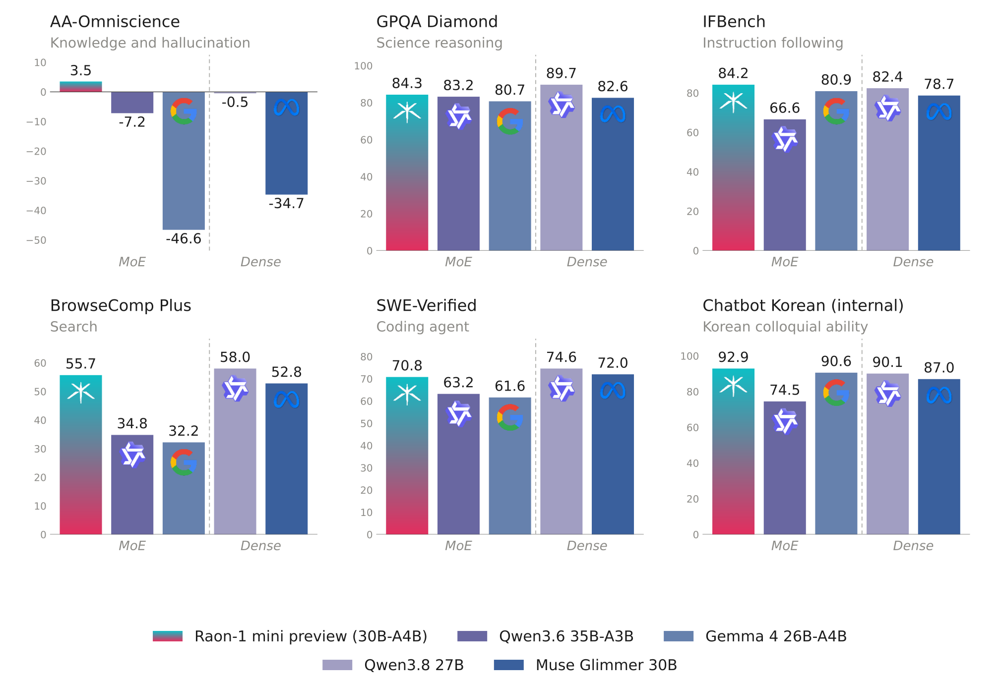

# Raon-1 mini

<div align="center">
  <picture>
    <source media="(prefers-color-scheme: dark)" srcset="assets/raon-1-mini-logo-dark.png">
    
  </picture>
</div>

<p align="center">
  <a href="https://krafton.ai/en/"></a>
  <br>
  <a href="https://huggingface.co/KRAFTON"></a>
  <a href="https://x.com/Krafton_AI"></a>
  <br>
  <a href="https://www.apache.org/licenses/LICENSE-2.0"></a>
</p>

Raon-1 mini is a 30B-A4B Mixture-of-Experts (MoE) language model, designed and **trained from scratch** by [KRAFTON AI](https://krafton.ai/en/). It demonstrates **strong capabilities in Korean conversation and agentic tasks**. As part of the Raon open model family, it is released under the **Apache 2.0 license**.

> [!TIP]
> Want to try Raon-1 mini without setting anything up?<br>
> Chat with it for free, for a limited time, in the [Raon-1 mini playground](https://raon-mini.krafton.ai).

> [!NOTE]
> This is a preview release, not a final model. Specs and results may change before the final version.

## Highlights

- **Reasoning**: Built-in thinking, with leading results on the math and science benchmarks shown below.
- **Instruction following and search**: Leads the comparison models on the instruction-following and search benchmarks shown below.
- **Korean and English**: Strong Korean language ability, and solid performance in English.
- **Agent execution**: Tool calling for agentic workflows, with support for Hermes Agent, Pi and OpenCode.
- **Speculative decoding support**: A DFlash2 draft model is provided for accelerated speculative decoding.
- **Quantization options**: Available in MXFP8 and NVFP4 formats, with NVFP4 enabling inference on a single NVIDIA RTX 5090 gpu (32 GB VRAM).

<picture>
  <source media="(prefers-color-scheme: dark)" srcset="assets/raon_benchmarks_top6-dark.png">
  
</picture>

## Model Overview

Raon-1 mini uses a hybrid Mixture-of-Experts (MoE) architecture, consisting of 18 linear attention layers and 7 full attention layers.

- **Raon Delta Attention (RDA):** Raon Delta Attention decouples the erase and write gates of Kimi Delta Attention, which improves long-context performance over KDA.
- **Raon-mHC:** Raon-mHC reduces the computational cost of DeepSeek’s manifold-constrained hyper-connections (mHC), which speeds up training.
- **Hybrid layout:** 18 of the 25 layers are Raon Delta Attention layers with a fixed-size state. Only the 7 MLA layers keep a KV cache, about 8 KiB per token in BF16.
- **Long context:** Natively supports up to 262,144 tokens of context.
- **Sparse MoE:** 6 of 128 routed experts plus 1 shared expert are active per token, so each token uses 4.3B of the 28.8B total parameters.

| Field | Value |
|---|---|
| Architecture | MoE |
| Total Parameters | 28.8B |
| Activated Parameters | 4.3B |
| Layers | 25 |
| Hidden Size | 2,560 |
| Attention | Hybrid — RDA 3 : Gated MLA 1 |
| Position Encoding | NoPE (no positional encoding) |
| Number of Attention Heads | 40 for both RDA & Gated MLA |
| Attention Head Dimension | 128 for RDA; 192 QK / 128 V, for Gated MLA |
| Query / KV LoRA Rank | 576 / 512, for Gated MLA |
| Number of Experts | 128 |
| Number of Activated Experts | 6 routed + 1 shared |
| Expert Intermediate Size | 1,088 |
| Dense FFN Intermediate Size (first layer)| 12,032 |
| Activation Function | SiTU-GLU |
| Residual Connection | Raon-mHC w/ 4 streams |
| Vocabulary Size | 259,840 |
| LM Head | Untied |
| Context Length | 262,144 tokens |

---

## Benchmark Results

* Red indicates the best performance of Raon-1 mini preview among MoE baselines.

<div style="font-family:'Pretendard','Noto Sans KR','Apple SD Gothic Neo','Malgun Gothic',system-ui,sans-serif;max-width:1180px;margin:0 auto;padding:0;">
<div>
<table style="font-family:'Pretendard','Noto Sans KR','Apple SD Gothic Neo','Malgun Gothic',system-ui,sans-serif;border-collapse:collapse;width:100%;table-layout:fixed;font-size:14px;">
<colgroup><col style="width:12%"><col style="width:22%"><col style="width:13.2%"><col style="width:13.2%"><col style="width:13.2%"><col style="width:13.2%"><col style="width:13.2%"></colgroup>
<thead>
<tr><th rowspan="2" style="font-family:'Pretendard','Noto Sans KR','Apple SD Gothic Neo','Malgun Gothic',system-ui,sans-serif;background:#000000;color:#ffffff;text-align:left;padding:12px 14px;font-weight:700;vertical-align:middle;">Category</th><th rowspan="2" style="font-family:'Pretendard','Noto Sans KR','Apple SD Gothic Neo','Malgun Gothic',system-ui,sans-serif;background:#000000;color:#ffffff;text-align:left;padding:12px 14px;font-weight:700;vertical-align:middle;">Benchmark</th><th colspan="3" style="font-family:'Pretendard','Noto Sans KR','Apple SD Gothic Neo','Malgun Gothic',system-ui,sans-serif;background:#000000;color:#ffffff;padding:10px 12px;font-weight:700;text-align:center;">MoE</th><th colspan="2" style="font-family:'Pretendard','Noto Sans KR','Apple SD Gothic Neo','Malgun Gothic',system-ui,sans-serif;background:#000000;color:#ffffff;padding:10px 12px;font-weight:700;text-align:center;border-left:2px solid #9a9a9a;">Dense</th></tr>
<tr><th style="font-family:'Pretendard','Noto Sans KR','Apple SD Gothic Neo','Malgun Gothic',system-ui,sans-serif;padding:10px 6px;font-weight:600;font-size:13px;color:#ffffff;text-align:center;line-height:1.35;background:#e0362f;">Raon-1 mini preview<br>(30B-A4B)</th><th style="font-family:'Pretendard','Noto Sans KR','Apple SD Gothic Neo','Malgun Gothic',system-ui,sans-serif;padding:10px 6px;font-weight:600;font-size:13px;color:#ffffff;text-align:center;line-height:1.35;background:#2a2a2a;">Qwen3.6-35B-A3B</th><th style="font-family:'Pretendard','Noto Sans KR','Apple SD Gothic Neo','Malgun Gothic',system-ui,sans-serif;padding:10px 6px;font-weight:600;font-size:13px;color:#ffffff;text-align:center;line-height:1.35;background:#2a2a2a;">Gemma 4 26B-A4B</th><th style="font-family:'Pretendard','Noto Sans KR','Apple SD Gothic Neo','Malgun Gothic',system-ui,sans-serif;padding:10px 6px;font-weight:600;font-size:13px;color:#ffffff;text-align:center;line-height:1.35;background:#2a2a2a;border-left:2px solid #9a9a9a;">Qwen3.8-27B</th><th style="font-family:'Pretendard','Noto Sans KR','Apple SD Gothic Neo','Malgun Gothic',system-ui,sans-serif;padding:10px 6px;font-weight:600;font-size:13px;color:#ffffff;text-align:center;line-height:1.35;background:#2a2a2a;">Muse Glimmer 30B</th></tr>
</thead>
<tbody>
<tr><td rowspan="2" style="font-family:'Pretendard','Noto Sans KR','Apple SD Gothic Neo','Malgun Gothic',system-ui,sans-serif;font-weight:700;text-align:left;vertical-align:middle;white-space:normal;border-bottom:1px solid #e6e6e6;background:#ffffff;color:#1a1a1a;">Knowledge</td><td style="font-family:'Pretendard','Noto Sans KR','Apple SD Gothic Neo','Malgun Gothic',system-ui,sans-serif;padding:12px 10px;border-bottom:1px solid #e6e6e6;color:#1a1a1a;font-weight:500;text-align:left;white-space:normal;background:#ffffff;">MMLU Pro</td><td style="font-family:'Pretendard','Noto Sans KR','Apple SD Gothic Neo','Malgun Gothic',system-ui,sans-serif;padding:12px 6px;border-bottom:1px solid #e6e6e6;text-align:center;color:#1a1a1a;font-size:15px;background:#fef0ef;">76.5</td><td style="font-family:'Pretendard','Noto Sans KR','Apple SD Gothic Neo','Malgun Gothic',system-ui,sans-serif;padding:12px 6px;border-bottom:1px solid #e6e6e6;text-align:center;color:#1a1a1a;font-size:15px;background:#ffffff;">85.9</td><td style="font-family:'Pretendard','Noto Sans KR','Apple SD Gothic Neo','Malgun Gothic',system-ui,sans-serif;padding:12px 6px;border-bottom:1px solid #e6e6e6;text-align:center;color:#1a1a1a;font-size:15px;background:#ffffff;">82.9</td><td style="font-family:'Pretendard','Noto Sans KR','Apple SD Gothic Neo','Malgun Gothic',system-ui,sans-serif;padding:12px 6px;border-bottom:1px solid #e6e6e6;text-align:center;color:#1a1a1a;font-size:15px;border-left:2px solid #9a9a9a;background:#ffffff;">85.7</td><td style="font-family:'Pretendard','Noto Sans KR','Apple SD Gothic Neo','Malgun Gothic',system-ui,sans-serif;padding:12px 6px;border-bottom:1px solid #e6e6e6;text-align:center;color:#1a1a1a;font-size:15px;background:#ffffff;">84.0</td></tr>
<tr><td style="font-family:'Pretendard','Noto Sans KR','Apple SD Gothic Neo','Malgun Gothic',system-ui,sans-serif;padding:12px 10px;border-bottom:1px solid #e6e6e6;color:#1a1a1a;font-weight:500;text-align:left;white-space:normal;background:#f7f7f7;">AA-Omniscience</td><td style="font-family:'Pretendard','Noto Sans KR','Apple SD Gothic Neo','Malgun Gothic',system-ui,sans-serif;padding:12px 6px;border-bottom:1px solid #e6e6e6;text-align:center;color:#1a1a1a;font-size:15px;background:#fde4e2;color:#e32e5e;">3.5</td><td style="font-family:'Pretendard','Noto Sans KR','Apple SD Gothic Neo','Malgun Gothic',system-ui,sans-serif;padding:12px 6px;border-bottom:1px solid #e6e6e6;text-align:center;color:#1a1a1a;font-size:15px;background:#f7f7f7;">−7.2</td><td style="font-family:'Pretendard','Noto Sans KR','Apple SD Gothic Neo','Malgun Gothic',system-ui,sans-serif;padding:12px 6px;border-bottom:1px solid #e6e6e6;text-align:center;color:#1a1a1a;font-size:15px;background:#f7f7f7;">−46.6</td><td style="font-family:'Pretendard','Noto Sans KR','Apple SD Gothic Neo','Malgun Gothic',system-ui,sans-serif;padding:12px 6px;border-bottom:1px solid #e6e6e6;text-align:center;color:#1a1a1a;font-size:15px;background:#f7f7f7;border-left:2px solid #9a9a9a;">−0.5</td><td style="font-family:'Pretendard','Noto Sans KR','Apple SD Gothic Neo','Malgun Gothic',system-ui,sans-serif;padding:12px 6px;border-bottom:1px solid #e6e6e6;text-align:center;color:#1a1a1a;font-size:15px;background:#f7f7f7;">−34.7</td></tr>
<tr><td rowspan="3" style="font-family:'Pretendard','Noto Sans KR','Apple SD Gothic Neo','Malgun Gothic',system-ui,sans-serif;font-weight:700;text-align:left;vertical-align:middle;white-space:normal;border-bottom:1px solid #e6e6e6;background:#ffffff;color:#1a1a1a;">Reasoning</td><td style="font-family:'Pretendard','Noto Sans KR','Apple SD Gothic Neo','Malgun Gothic',system-ui,sans-serif;padding:12px 10px;border-bottom:1px solid #e6e6e6;color:#1a1a1a;font-weight:500;text-align:left;white-space:normal;background:#ffffff;">GPQA Diamond</td><td style="font-family:'Pretendard','Noto Sans KR','Apple SD Gothic Neo','Malgun Gothic',system-ui,sans-serif;padding:12px 6px;border-bottom:1px solid #e6e6e6;text-align:center;color:#1a1a1a;font-size:15px;background:#fef0ef;color:#e32e5e;">84.3</td><td style="font-family:'Pretendard','Noto Sans KR','Apple SD Gothic Neo','Malgun Gothic',system-ui,sans-serif;padding:12px 6px;border-bottom:1px solid #e6e6e6;text-align:center;color:#1a1a1a;font-size:15px;background:#ffffff;">83.2</td><td style="font-family:'Pretendard','Noto Sans KR','Apple SD Gothic Neo','Malgun Gothic',system-ui,sans-serif;padding:12px 6px;border-bottom:1px solid #e6e6e6;text-align:center;color:#1a1a1a;font-size:15px;background:#ffffff;">80.7</td><td style="font-family:'Pretendard','Noto Sans KR','Apple SD Gothic Neo','Malgun Gothic',system-ui,sans-serif;padding:12px 6px;border-bottom:1px solid #e6e6e6;text-align:center;color:#1a1a1a;font-size:15px;border-left:2px solid #9a9a9a;background:#ffffff;">89.7</td><td style="font-family:'Pretendard','Noto Sans KR','Apple SD Gothic Neo','Malgun Gothic',system-ui,sans-serif;padding:12px 6px;border-bottom:1px solid #e6e6e6;text-align:center;color:#1a1a1a;font-size:15px;background:#ffffff;">82.6</td></tr>
<tr><td style="font-family:'Pretendard','Noto Sans KR','Apple SD Gothic Neo','Malgun Gothic',system-ui,sans-serif;padding:12px 10px;border-bottom:1px solid #e6e6e6;color:#1a1a1a;font-weight:500;text-align:left;white-space:normal;background:#f7f7f7;">AIME 2026</td><td style="font-family:'Pretendard','Noto Sans KR','Apple SD Gothic Neo','Malgun Gothic',system-ui,sans-serif;padding:12px 6px;border-bottom:1px solid #e6e6e6;text-align:center;color:#1a1a1a;font-size:15px;background:#fde4e2;color:#e32e5e;">93.3</td><td style="font-family:'Pretendard','Noto Sans KR','Apple SD Gothic Neo','Malgun Gothic',system-ui,sans-serif;padding:12px 6px;border-bottom:1px solid #e6e6e6;text-align:center;color:#1a1a1a;font-size:15px;background:#f7f7f7;">92.9</td><td style="font-family:'Pretendard','Noto Sans KR','Apple SD Gothic Neo','Malgun Gothic',system-ui,sans-serif;padding:12px 6px;border-bottom:1px solid #e6e6e6;text-align:center;color:#1a1a1a;font-size:15px;background:#f7f7f7;">87.1</td><td style="font-family:'Pretendard','Noto Sans KR','Apple SD Gothic Neo','Malgun Gothic',system-ui,sans-serif;padding:12px 6px;border-bottom:1px solid #e6e6e6;text-align:center;color:#1a1a1a;font-size:15px;background:#f7f7f7;border-left:2px solid #9a9a9a;">98.8</td><td style="font-family:'Pretendard','Noto Sans KR','Apple SD Gothic Neo','Malgun Gothic',system-ui,sans-serif;padding:12px 6px;border-bottom:1px solid #e6e6e6;text-align:center;color:#1a1a1a;font-size:15px;background:#f7f7f7;">92.9</td></tr>
<tr><td style="font-family:'Pretendard','Noto Sans KR','Apple SD Gothic Neo','Malgun Gothic',system-ui,sans-serif;padding:12px 10px;border-bottom:1px solid #e6e6e6;color:#1a1a1a;font-weight:500;text-align:left;white-space:normal;background:#ffffff;">HMMT Feb 2026</td><td style="font-family:'Pretendard','Noto Sans KR','Apple SD Gothic Neo','Malgun Gothic',system-ui,sans-serif;padding:12px 6px;border-bottom:1px solid #e6e6e6;text-align:center;color:#1a1a1a;font-size:15px;background:#fef0ef;">84.1</td><td style="font-family:'Pretendard','Noto Sans KR','Apple SD Gothic Neo','Malgun Gothic',system-ui,sans-serif;padding:12px 6px;border-bottom:1px solid #e6e6e6;text-align:center;color:#1a1a1a;font-size:15px;background:#ffffff;">84.5</td><td style="font-family:'Pretendard','Noto Sans KR','Apple SD Gothic Neo','Malgun Gothic',system-ui,sans-serif;padding:12px 6px;border-bottom:1px solid #e6e6e6;text-align:center;color:#1a1a1a;font-size:15px;background:#ffffff;">79.9</td><td style="font-family:'Pretendard','Noto Sans KR','Apple SD Gothic Neo','Malgun Gothic',system-ui,sans-serif;padding:12px 6px;border-bottom:1px solid #e6e6e6;text-align:center;color:#1a1a1a;font-size:15px;border-left:2px solid #9a9a9a;background:#ffffff;">95.8</td><td style="font-family:'Pretendard','Noto Sans KR','Apple SD Gothic Neo','Malgun Gothic',system-ui,sans-serif;padding:12px 6px;border-bottom:1px solid #e6e6e6;text-align:center;color:#1a1a1a;font-size:15px;background:#ffffff;">74.6</td></tr>
<tr><td rowspan="2" style="font-family:'Pretendard','Noto Sans KR','Apple SD Gothic Neo','Malgun Gothic',system-ui,sans-serif;font-weight:700;text-align:left;vertical-align:middle;white-space:normal;border-bottom:1px solid #e6e6e6;background:#ffffff;color:#1a1a1a;">Instruction and multi-turn</td><td style="font-family:'Pretendard','Noto Sans KR','Apple SD Gothic Neo','Malgun Gothic',system-ui,sans-serif;padding:12px 10px;border-bottom:1px solid #e6e6e6;color:#1a1a1a;font-weight:500;text-align:left;white-space:normal;background:#f7f7f7;">IFBench</td><td style="font-family:'Pretendard','Noto Sans KR','Apple SD Gothic Neo','Malgun Gothic',system-ui,sans-serif;padding:12px 6px;border-bottom:1px solid #e6e6e6;text-align:center;color:#1a1a1a;font-size:15px;background:#fde4e2;color:#e32e5e;">84.2</td><td style="font-family:'Pretendard','Noto Sans KR','Apple SD Gothic Neo','Malgun Gothic',system-ui,sans-serif;padding:12px 6px;border-bottom:1px solid #e6e6e6;text-align:center;color:#1a1a1a;font-size:15px;background:#f7f7f7;">66.6</td><td style="font-family:'Pretendard','Noto Sans KR','Apple SD Gothic Neo','Malgun Gothic',system-ui,sans-serif;padding:12px 6px;border-bottom:1px solid #e6e6e6;text-align:center;color:#1a1a1a;font-size:15px;background:#f7f7f7;">80.9</td><td style="font-family:'Pretendard','Noto Sans KR','Apple SD Gothic Neo','Malgun Gothic',system-ui,sans-serif;padding:12px 6px;border-bottom:1px solid #e6e6e6;text-align:center;color:#1a1a1a;font-size:15px;background:#f7f7f7;border-left:2px solid #9a9a9a;">82.4</td><td style="font-family:'Pretendard','Noto Sans KR','Apple SD Gothic Neo','Malgun Gothic',system-ui,sans-serif;padding:12px 6px;border-bottom:1px solid #e6e6e6;text-align:center;color:#1a1a1a;font-size:15px;background:#f7f7f7;">78.7</td></tr>
<tr><td style="font-family:'Pretendard','Noto Sans KR','Apple SD Gothic Neo','Malgun Gothic',system-ui,sans-serif;padding:12px 10px;border-bottom:1px solid #e6e6e6;color:#1a1a1a;font-weight:500;text-align:left;white-space:normal;background:#ffffff;">MultiChallenge</td><td style="font-family:'Pretendard','Noto Sans KR','Apple SD Gothic Neo','Malgun Gothic',system-ui,sans-serif;padding:12px 6px;border-bottom:1px solid #e6e6e6;text-align:center;color:#1a1a1a;font-size:15px;background:#fef0ef;color:#e32e5e;">59.0</td><td style="font-family:'Pretendard','Noto Sans KR','Apple SD Gothic Neo','Malgun Gothic',system-ui,sans-serif;padding:12px 6px;border-bottom:1px solid #e6e6e6;text-align:center;color:#1a1a1a;font-size:15px;background:#ffffff;">58.2</td><td style="font-family:'Pretendard','Noto Sans KR','Apple SD Gothic Neo','Malgun Gothic',system-ui,sans-serif;padding:12px 6px;border-bottom:1px solid #e6e6e6;text-align:center;color:#1a1a1a;font-size:15px;background:#ffffff;">58.4</td><td style="font-family:'Pretendard','Noto Sans KR','Apple SD Gothic Neo','Malgun Gothic',system-ui,sans-serif;padding:12px 6px;border-bottom:1px solid #e6e6e6;text-align:center;color:#1a1a1a;font-size:15px;border-left:2px solid #9a9a9a;background:#ffffff;">63.6</td><td style="font-family:'Pretendard','Noto Sans KR','Apple SD Gothic Neo','Malgun Gothic',system-ui,sans-serif;padding:12px 6px;border-bottom:1px solid #e6e6e6;text-align:center;color:#1a1a1a;font-size:15px;background:#ffffff;">63.4</td></tr>
<tr><td rowspan="4" style="font-family:'Pretendard','Noto Sans KR','Apple SD Gothic Neo','Malgun Gothic',system-ui,sans-serif;font-weight:700;text-align:left;vertical-align:middle;white-space:normal;border-bottom:1px solid #e6e6e6;background:#ffffff;color:#1a1a1a;">Coding</td><td style="font-family:'Pretendard','Noto Sans KR','Apple SD Gothic Neo','Malgun Gothic',system-ui,sans-serif;padding:12px 10px;border-bottom:1px solid #e6e6e6;color:#1a1a1a;font-weight:500;text-align:left;white-space:normal;background:#f7f7f7;">LiveCodeBench v6</td><td style="font-family:'Pretendard','Noto Sans KR','Apple SD Gothic Neo','Malgun Gothic',system-ui,sans-serif;padding:12px 6px;border-bottom:1px solid #e6e6e6;text-align:center;color:#1a1a1a;font-size:15px;background:#fde4e2;">81.6</td><td style="font-family:'Pretendard','Noto Sans KR','Apple SD Gothic Neo','Malgun Gothic',system-ui,sans-serif;padding:12px 6px;border-bottom:1px solid #e6e6e6;text-align:center;color:#1a1a1a;font-size:15px;background:#f7f7f7;">81.2</td><td style="font-family:'Pretendard','Noto Sans KR','Apple SD Gothic Neo','Malgun Gothic',system-ui,sans-serif;padding:12px 6px;border-bottom:1px solid #e6e6e6;text-align:center;color:#1a1a1a;font-size:15px;background:#f7f7f7;">83.4</td><td style="font-family:'Pretendard','Noto Sans KR','Apple SD Gothic Neo','Malgun Gothic',system-ui,sans-serif;padding:12px 6px;border-bottom:1px solid #e6e6e6;text-align:center;color:#1a1a1a;font-size:15px;background:#f7f7f7;border-left:2px solid #9a9a9a;">79.3</td><td style="font-family:'Pretendard','Noto Sans KR','Apple SD Gothic Neo','Malgun Gothic',system-ui,sans-serif;padding:12px 6px;border-bottom:1px solid #e6e6e6;text-align:center;color:#1a1a1a;font-size:15px;background:#f7f7f7;">77.4</td></tr>
<tr><td style="font-family:'Pretendard','Noto Sans KR','Apple SD Gothic Neo','Malgun Gothic',system-ui,sans-serif;padding:12px 10px;border-bottom:1px solid #e6e6e6;color:#1a1a1a;font-weight:500;text-align:left;white-space:normal;background:#ffffff;">SciCode</td><td style="font-family:'Pretendard','Noto Sans KR','Apple SD Gothic Neo','Malgun Gothic',system-ui,sans-serif;padding:12px 6px;border-bottom:1px solid #e6e6e6;text-align:center;color:#1a1a1a;font-size:15px;background:#fef0ef;">38.7</td><td style="font-family:'Pretendard','Noto Sans KR','Apple SD Gothic Neo','Malgun Gothic',system-ui,sans-serif;padding:12px 6px;border-bottom:1px solid #e6e6e6;text-align:center;color:#1a1a1a;font-size:15px;background:#ffffff;">35.6</td><td style="font-family:'Pretendard','Noto Sans KR','Apple SD Gothic Neo','Malgun Gothic',system-ui,sans-serif;padding:12px 6px;border-bottom:1px solid #e6e6e6;text-align:center;color:#1a1a1a;font-size:15px;background:#ffffff;">39.6</td><td style="font-family:'Pretendard','Noto Sans KR','Apple SD Gothic Neo','Malgun Gothic',system-ui,sans-serif;padding:12px 6px;border-bottom:1px solid #e6e6e6;text-align:center;color:#1a1a1a;font-size:15px;border-left:2px solid #9a9a9a;background:#ffffff;">44.6</td><td style="font-family:'Pretendard','Noto Sans KR','Apple SD Gothic Neo','Malgun Gothic',system-ui,sans-serif;padding:12px 6px;border-bottom:1px solid #e6e6e6;text-align:center;color:#1a1a1a;font-size:15px;background:#ffffff;">43.6</td></tr>
<tr><td style="font-family:'Pretendard','Noto Sans KR','Apple SD Gothic Neo','Malgun Gothic',system-ui,sans-serif;padding:12px 10px;border-bottom:1px solid #e6e6e6;color:#1a1a1a;font-weight:500;text-align:left;white-space:normal;background:#f7f7f7;">SWE-Verified¹</td><td style="font-family:'Pretendard','Noto Sans KR','Apple SD Gothic Neo','Malgun Gothic',system-ui,sans-serif;padding:12px 6px;border-bottom:1px solid #e6e6e6;text-align:center;color:#1a1a1a;font-size:15px;background:#fde4e2;color:#e32e5e;">70.8</td><td style="font-family:'Pretendard','Noto Sans KR','Apple SD Gothic Neo','Malgun Gothic',system-ui,sans-serif;padding:12px 6px;border-bottom:1px solid #e6e6e6;text-align:center;color:#1a1a1a;font-size:15px;background:#f7f7f7;">63.2</td><td style="font-family:'Pretendard','Noto Sans KR','Apple SD Gothic Neo','Malgun Gothic',system-ui,sans-serif;padding:12px 6px;border-bottom:1px solid #e6e6e6;text-align:center;color:#1a1a1a;font-size:15px;background:#f7f7f7;">61.6</td><td style="font-family:'Pretendard','Noto Sans KR','Apple SD Gothic Neo','Malgun Gothic',system-ui,sans-serif;padding:12px 6px;border-bottom:1px solid #e6e6e6;text-align:center;color:#1a1a1a;font-size:15px;background:#f7f7f7;border-left:2px solid #9a9a9a;">74.6</td><td style="font-family:'Pretendard','Noto Sans KR','Apple SD Gothic Neo','Malgun Gothic',system-ui,sans-serif;padding:12px 6px;border-bottom:1px solid #e6e6e6;text-align:center;color:#1a1a1a;font-size:15px;background:#f7f7f7;">72.0</td></tr>
<tr><td style="font-family:'Pretendard','Noto Sans KR','Apple SD Gothic Neo','Malgun Gothic',system-ui,sans-serif;padding:12px 10px;border-bottom:1px solid #e6e6e6;color:#1a1a1a;font-weight:500;text-align:left;white-space:normal;background:#ffffff;">Terminal-Bench Lite</td><td style="font-family:'Pretendard','Noto Sans KR','Apple SD Gothic Neo','Malgun Gothic',system-ui,sans-serif;padding:12px 6px;border-bottom:1px solid #e6e6e6;text-align:center;color:#1a1a1a;font-size:15px;background:#fef0ef;">47.0</td><td style="font-family:'Pretendard','Noto Sans KR','Apple SD Gothic Neo','Malgun Gothic',system-ui,sans-serif;padding:12px 6px;border-bottom:1px solid #e6e6e6;text-align:center;color:#1a1a1a;font-size:15px;background:#ffffff;">63.3</td><td style="font-family:'Pretendard','Noto Sans KR','Apple SD Gothic Neo','Malgun Gothic',system-ui,sans-serif;padding:12px 6px;border-bottom:1px solid #e6e6e6;text-align:center;color:#1a1a1a;font-size:15px;background:#ffffff;">52.0</td><td style="font-family:'Pretendard','Noto Sans KR','Apple SD Gothic Neo','Malgun Gothic',system-ui,sans-serif;padding:12px 6px;border-bottom:1px solid #e6e6e6;text-align:center;color:#1a1a1a;font-size:15px;border-left:2px solid #9a9a9a;background:#ffffff;">67.0</td><td style="font-family:'Pretendard','Noto Sans KR','Apple SD Gothic Neo','Malgun Gothic',system-ui,sans-serif;padding:12px 6px;border-bottom:1px solid #e6e6e6;text-align:center;color:#1a1a1a;font-size:15px;background:#ffffff;">70.7</td></tr>
<tr><td rowspan="4" style="font-family:'Pretendard','Noto Sans KR','Apple SD Gothic Neo','Malgun Gothic',system-ui,sans-serif;font-weight:700;text-align:left;vertical-align:middle;white-space:normal;border-bottom:1px solid #e6e6e6;background:#ffffff;color:#1a1a1a;">Agentic</td><td style="font-family:'Pretendard','Noto Sans KR','Apple SD Gothic Neo','Malgun Gothic',system-ui,sans-serif;padding:12px 10px;border-bottom:1px solid #e6e6e6;color:#1a1a1a;font-weight:500;text-align:left;white-space:normal;background:#f7f7f7;">GDPVal²</td><td style="font-family:'Pretendard','Noto Sans KR','Apple SD Gothic Neo','Malgun Gothic',system-ui,sans-serif;padding:12px 6px;border-bottom:1px solid #e6e6e6;text-align:center;color:#1a1a1a;font-size:15px;background:#fde4e2;">66.0</td><td style="font-family:'Pretendard','Noto Sans KR','Apple SD Gothic Neo','Malgun Gothic',system-ui,sans-serif;padding:12px 6px;border-bottom:1px solid #e6e6e6;text-align:center;color:#1a1a1a;font-size:15px;background:#f7f7f7;">67.4</td><td style="font-family:'Pretendard','Noto Sans KR','Apple SD Gothic Neo','Malgun Gothic',system-ui,sans-serif;padding:12px 6px;border-bottom:1px solid #e6e6e6;text-align:center;color:#1a1a1a;font-size:15px;background:#f7f7f7;">57.5</td><td style="font-family:'Pretendard','Noto Sans KR','Apple SD Gothic Neo','Malgun Gothic',system-ui,sans-serif;padding:12px 6px;border-bottom:1px solid #e6e6e6;text-align:center;color:#1a1a1a;font-size:15px;background:#f7f7f7;border-left:2px solid #9a9a9a;">63.5</td><td style="font-family:'Pretendard','Noto Sans KR','Apple SD Gothic Neo','Malgun Gothic',system-ui,sans-serif;padding:12px 6px;border-bottom:1px solid #e6e6e6;text-align:center;color:#1a1a1a;font-size:15px;background:#f7f7f7;">67.3</td></tr>
<tr><td style="font-family:'Pretendard','Noto Sans KR','Apple SD Gothic Neo','Malgun Gothic',system-ui,sans-serif;padding:12px 10px;border-bottom:1px solid #e6e6e6;color:#1a1a1a;font-weight:500;text-align:left;white-space:normal;background:#ffffff;">AutomationBench³</td><td style="font-family:'Pretendard','Noto Sans KR','Apple SD Gothic Neo','Malgun Gothic',system-ui,sans-serif;padding:12px 6px;border-bottom:1px solid #e6e6e6;text-align:center;color:#1a1a1a;font-size:15px;background:#fef0ef;">29.7</td><td style="font-family:'Pretendard','Noto Sans KR','Apple SD Gothic Neo','Malgun Gothic',system-ui,sans-serif;padding:12px 6px;border-bottom:1px solid #e6e6e6;text-align:center;color:#1a1a1a;font-size:15px;background:#ffffff;">24.9</td><td style="font-family:'Pretendard','Noto Sans KR','Apple SD Gothic Neo','Malgun Gothic',system-ui,sans-serif;padding:12px 6px;border-bottom:1px solid #e6e6e6;text-align:center;color:#1a1a1a;font-size:15px;background:#ffffff;">36.2</td><td style="font-family:'Pretendard','Noto Sans KR','Apple SD Gothic Neo','Malgun Gothic',system-ui,sans-serif;padding:12px 6px;border-bottom:1px solid #e6e6e6;text-align:center;color:#1a1a1a;font-size:15px;border-left:2px solid #9a9a9a;background:#ffffff;">58.7</td><td style="font-family:'Pretendard','Noto Sans KR','Apple SD Gothic Neo','Malgun Gothic',system-ui,sans-serif;padding:12px 6px;border-bottom:1px solid #e6e6e6;text-align:center;color:#1a1a1a;font-size:15px;background:#ffffff;">32.1</td></tr>
<tr><td style="font-family:'Pretendard','Noto Sans KR','Apple SD Gothic Neo','Malgun Gothic',system-ui,sans-serif;padding:12px 10px;border-bottom:1px solid #e6e6e6;color:#1a1a1a;font-weight:500;text-align:left;white-space:normal;background:#f7f7f7;">BrowseComp Plus</td><td style="font-family:'Pretendard','Noto Sans KR','Apple SD Gothic Neo','Malgun Gothic',system-ui,sans-serif;padding:12px 6px;border-bottom:1px solid #e6e6e6;text-align:center;color:#1a1a1a;font-size:15px;background:#fde4e2;color:#e32e5e;">55.7</td><td style="font-family:'Pretendard','Noto Sans KR','Apple SD Gothic Neo','Malgun Gothic',system-ui,sans-serif;padding:12px 6px;border-bottom:1px solid #e6e6e6;text-align:center;color:#1a1a1a;font-size:15px;background:#f7f7f7;">34.8</td><td style="font-family:'Pretendard','Noto Sans KR','Apple SD Gothic Neo','Malgun Gothic',system-ui,sans-serif;padding:12px 6px;border-bottom:1px solid #e6e6e6;text-align:center;color:#1a1a1a;font-size:15px;background:#f7f7f7;">32.2</td><td style="font-family:'Pretendard','Noto Sans KR','Apple SD Gothic Neo','Malgun Gothic',system-ui,sans-serif;padding:12px 6px;border-bottom:1px solid #e6e6e6;text-align:center;color:#1a1a1a;font-size:15px;background:#f7f7f7;border-left:2px solid #9a9a9a;">58.0</td><td style="font-family:'Pretendard','Noto Sans KR','Apple SD Gothic Neo','Malgun Gothic',system-ui,sans-serif;padding:12px 6px;border-bottom:1px solid #e6e6e6;text-align:center;color:#1a1a1a;font-size:15px;background:#f7f7f7;">52.8</td></tr>
<tr><td style="font-family:'Pretendard','Noto Sans KR','Apple SD Gothic Neo','Malgun Gothic',system-ui,sans-serif;padding:12px 10px;border-bottom:1px solid #e6e6e6;color:#1a1a1a;font-weight:500;text-align:left;white-space:normal;background:#ffffff;">BFCL v4 Overall</td><td style="font-family:'Pretendard','Noto Sans KR','Apple SD Gothic Neo','Malgun Gothic',system-ui,sans-serif;padding:12px 6px;border-bottom:1px solid #e6e6e6;text-align:center;color:#1a1a1a;font-size:15px;background:#fef0ef;">59.8</td><td style="font-family:'Pretendard','Noto Sans KR','Apple SD Gothic Neo','Malgun Gothic',system-ui,sans-serif;padding:12px 6px;border-bottom:1px solid #e6e6e6;text-align:center;color:#1a1a1a;font-size:15px;background:#ffffff;">64.7</td><td style="font-family:'Pretendard','Noto Sans KR','Apple SD Gothic Neo','Malgun Gothic',system-ui,sans-serif;padding:12px 6px;border-bottom:1px solid #e6e6e6;text-align:center;color:#1a1a1a;font-size:15px;background:#ffffff;">65.8</td><td style="font-family:'Pretendard','Noto Sans KR','Apple SD Gothic Neo','Malgun Gothic',system-ui,sans-serif;padding:12px 6px;border-bottom:1px solid #e6e6e6;text-align:center;color:#1a1a1a;font-size:15px;border-left:2px solid #9a9a9a;background:#ffffff;">72.4</td><td style="font-family:'Pretendard','Noto Sans KR','Apple SD Gothic Neo','Malgun Gothic',system-ui,sans-serif;padding:12px 6px;border-bottom:1px solid #e6e6e6;text-align:center;color:#1a1a1a;font-size:15px;background:#ffffff;">51.8</td></tr>
<tr><td rowspan="2" style="font-family:'Pretendard','Noto Sans KR','Apple SD Gothic Neo','Malgun Gothic',system-ui,sans-serif;font-weight:700;text-align:left;vertical-align:middle;white-space:normal;border-bottom:1px solid #e6e6e6;background:#ffffff;color:#1a1a1a;">Long context</td><td style="font-family:'Pretendard','Noto Sans KR','Apple SD Gothic Neo','Malgun Gothic',system-ui,sans-serif;padding:12px 10px;border-bottom:1px solid #e6e6e6;color:#1a1a1a;font-weight:500;text-align:left;white-space:normal;background:#f7f7f7;">AA-LCR</td><td style="font-family:'Pretendard','Noto Sans KR','Apple SD Gothic Neo','Malgun Gothic',system-ui,sans-serif;padding:12px 6px;border-bottom:1px solid #e6e6e6;text-align:center;color:#1a1a1a;font-size:15px;background:#fde4e2;">67.3</td><td style="font-family:'Pretendard','Noto Sans KR','Apple SD Gothic Neo','Malgun Gothic',system-ui,sans-serif;padding:12px 6px;border-bottom:1px solid #e6e6e6;text-align:center;color:#1a1a1a;font-size:15px;background:#f7f7f7;">69.3</td><td style="font-family:'Pretendard','Noto Sans KR','Apple SD Gothic Neo','Malgun Gothic',system-ui,sans-serif;padding:12px 6px;border-bottom:1px solid #e6e6e6;text-align:center;color:#1a1a1a;font-size:15px;background:#f7f7f7;">67.0</td><td style="font-family:'Pretendard','Noto Sans KR','Apple SD Gothic Neo','Malgun Gothic',system-ui,sans-serif;padding:12px 6px;border-bottom:1px solid #e6e6e6;text-align:center;color:#1a1a1a;font-size:15px;background:#f7f7f7;border-left:2px solid #9a9a9a;">80.3</td><td style="font-family:'Pretendard','Noto Sans KR','Apple SD Gothic Neo','Malgun Gothic',system-ui,sans-serif;padding:12px 6px;border-bottom:1px solid #e6e6e6;text-align:center;color:#1a1a1a;font-size:15px;background:#f7f7f7;">81.3</td></tr>
<tr><td style="font-family:'Pretendard','Noto Sans KR','Apple SD Gothic Neo','Malgun Gothic',system-ui,sans-serif;padding:12px 10px;border-bottom:1px solid #e6e6e6;color:#1a1a1a;font-weight:500;text-align:left;white-space:normal;background:#ffffff;">GDP.pdf⁴</td><td style="font-family:'Pretendard','Noto Sans KR','Apple SD Gothic Neo','Malgun Gothic',system-ui,sans-serif;padding:12px 6px;border-bottom:1px solid #e6e6e6;text-align:center;color:#1a1a1a;font-size:15px;background:#fef0ef;">5.8</td><td style="font-family:'Pretendard','Noto Sans KR','Apple SD Gothic Neo','Malgun Gothic',system-ui,sans-serif;padding:12px 6px;border-bottom:1px solid #e6e6e6;text-align:center;color:#1a1a1a;font-size:15px;background:#ffffff;">6.6</td><td style="font-family:'Pretendard','Noto Sans KR','Apple SD Gothic Neo','Malgun Gothic',system-ui,sans-serif;padding:12px 6px;border-bottom:1px solid #e6e6e6;text-align:center;color:#1a1a1a;font-size:15px;background:#ffffff;">3.6</td><td style="font-family:'Pretendard','Noto Sans KR','Apple SD Gothic Neo','Malgun Gothic',system-ui,sans-serif;padding:12px 6px;border-bottom:1px solid #e6e6e6;text-align:center;color:#1a1a1a;font-size:15px;border-left:2px solid #9a9a9a;background:#ffffff;">11.2</td><td style="font-family:'Pretendard','Noto Sans KR','Apple SD Gothic Neo','Malgun Gothic',system-ui,sans-serif;padding:12px 6px;border-bottom:1px solid #e6e6e6;text-align:center;color:#1a1a1a;font-size:15px;background:#ffffff;">8.4</td></tr>
<tr><td rowspan="1" style="font-family:'Pretendard','Noto Sans KR','Apple SD Gothic Neo','Malgun Gothic',system-ui,sans-serif;font-weight:700;text-align:left;vertical-align:middle;white-space:normal;border-bottom:1px solid #e6e6e6;background:#ffffff;color:#1a1a1a;">Korean conversation</td><td style="font-family:'Pretendard','Noto Sans KR','Apple SD Gothic Neo','Malgun Gothic',system-ui,sans-serif;padding:12px 10px;border-bottom:1px solid #e6e6e6;color:#1a1a1a;font-weight:500;text-align:left;white-space:normal;background:#f7f7f7;">Chatbot Korean (internal)⁵</td><td style="font-family:'Pretendard','Noto Sans KR','Apple SD Gothic Neo','Malgun Gothic',system-ui,sans-serif;padding:12px 6px;border-bottom:1px solid #e6e6e6;text-align:center;color:#1a1a1a;font-size:15px;background:#fde4e2;color:#e32e5e;">92.9</td><td style="font-family:'Pretendard','Noto Sans KR','Apple SD Gothic Neo','Malgun Gothic',system-ui,sans-serif;padding:12px 6px;border-bottom:1px solid #e6e6e6;text-align:center;color:#1a1a1a;font-size:15px;background:#f7f7f7;">74.5</td><td style="font-family:'Pretendard','Noto Sans KR','Apple SD Gothic Neo','Malgun Gothic',system-ui,sans-serif;padding:12px 6px;border-bottom:1px solid #e6e6e6;text-align:center;color:#1a1a1a;font-size:15px;background:#f7f7f7;">90.6</td><td style="font-family:'Pretendard','Noto Sans KR','Apple SD Gothic Neo','Malgun Gothic',system-ui,sans-serif;padding:12px 6px;border-bottom:1px solid #e6e6e6;text-align:center;color:#1a1a1a;font-size:15px;background:#f7f7f7;border-left:2px solid #9a9a9a;">90.1</td><td style="font-family:'Pretendard','Noto Sans KR','Apple SD Gothic Neo','Malgun Gothic',system-ui,sans-serif;padding:12px 6px;border-bottom:1px solid #e6e6e6;text-align:center;color:#1a1a1a;font-size:15px;background:#f7f7f7;">87.0</td></tr>
</tbody>
</table>
</div>
</div>
<p style="margin:0;font-size:10px;opacity:0.7">
Judge and user simulator: gpt-5.6-luna for all evaluations.<br/>
Red = Raon-1 mini preview is best within the MoE group (Raon-1 mini preview, Qwen3.6-35B-A3B, Gemma 4 26B-A4B). Dense models (Qwen3.8-27B, Muse Glimmer 30B) are shown for reference only.<br/>
¹ SWE-Verified: evaluated with the mini-SWE-agent harness.<br/>
² GDPVal (<a href="https://huggingface.co/datasets/openai/gdpval">dataset</a>): metric is a judge score, not Elo.<br/>
³ AutomationBench: public split, not the official evaluation set.<br/>
⁴ GDP.pdf: official Artificial Analysis (artificialanalysis.ai) text-only version. PDFs are OCR-ed in advance; no image input.
<br/>
⁵ Chatbot Korean (internal): an internal benchmark measuring Korean colloquial ability in chatbot conversations across diverse situations. Not publicly released.</p>

## Sampling parameters

> [!Important]
> Raon-1 mini is designed for thinking mode; disabling it is not recommended.

Settings shared by all tasks:

| Setting | Value |
|---|---|
| temperature | 1.0 |
| top_p | 0.95 |
| top_k | 20 |
| repetition_penalty | 1.0 |
| frequency_penalty | 0 |
| min_p | 0 |
| truncate_history_thinking | false |

Settings that depend on the task:

| Task | presence_penalty |
|---|---|
| Coding / math | 0 |
| Everything else (chat, summarization, knowledge Q&A, agents, etc.) | 1.5 |

<!-- ```python
# Coding / math
sampling = dict(temperature=1.0, top_p=0.95, top_k=20, presence_penalty=0.0, repetition_penalty=1.0, frequency_penalty=0.0, min_p=0.0)

# Everything else
sampling = dict(temperature=1.0, top_p=0.95, top_k=20, presence_penalty=1.5, repetition_penalty=1.0, frequency_penalty=0.0, min_p=0.0)
``` -->

## Speculative Decoding

We release a [DFlash2](https://github.com/z-lab/dflash) draft model alongside Raon-1 mini preview to accelerate inference through speculative decoding. In our benchmarks on a single NVIDIA B300, it delivers **up to 2.18× higher output throughput** than autoregressive decoding. Speedups vary by hardware and workload.

Throughput is measured in output tok/s, with speedup over autoregressive decoding in parentheses. Acceptance length (AL) is 1 + total accepted draft tokens divided by total draft steps, measured at concurrency 1.

| Benchmark | AL | AR · C=1 | DFlash2 · C=1 | AR · C=8 | DFlash2 · C=8 | AR · C=32 | DFlash2 · C=32 |
| :--- | ---: | ---: | ---: | ---: | ---: | ---: | ---: |
| GSM8K | 3.77 | 296.3 | **646.3 (2.18×)** | 1,110.4 | **1,836.3 (1.65×)** | 1,528.9 | **2,619.3 (1.71×)** |
| MATH-500 | 3.58 | 308.0 | **666.6 (2.16×)** | 1,496.1 | **2,511.3 (1.68×)** | 3,082.5 | **5,166.9 (1.68×)** |
| HumanEval | 3.26 | 305.4 | **607.9 (1.99×)** | 1,470.8 | **2,269.6 (1.54×)** | 2,793.1 | **4,596.4 (1.65×)** |
| MBPP | 3.21 | 307.0 | **604.1 (1.97×)** | 1,450.6 | **2,197.2 (1.51×)** | 2,956.2 | **5,017.9 (1.70×)** |
| MT-Bench | 2.97 | 304.9 | **570.2 (1.87×)** | 1,477.1 | **2,038.2 (1.38×)** | 2,521.3 | **3,935.4 (1.56×)** |

<small>
AR: autoregressive decoding; C: concurrency.
Throughput is total output tokens divided by end-to-end wall time.<br>
Evaluated with vLLM 0.28.0 and an MXFP8 target model; block size 8
(7 draft tokens), probabilistic draft sampling, temperature 1.0,
top-p 0.95, top-k 20, thinking enabled, up to 4,096 new tokens,
and 128 prompts per benchmark (80 for MT-Bench).

</small>

## Quickstart

Raon-1 mini supports inference with Transformers, vLLM, llama.cpp,
and MLX. The examples below show how to run the model locally or
launch an OpenAI-compatible server, using thinking mode and the
recommended sampling settings above.


<summary><strong>Transformers</strong></summary>

Use Hugging Face Transformers to load Raon-1 mini and generate
responses directly in Python.

Install the dependencies:

```bash
uv venv --python 3.12 --seed
source .venv/bin/activate

pip install \
    "transformers==5.16.1" \
    "accelerate==1.15.0"
```

Then run the model:

```python
from transformers import AutoModelForCausalLM, AutoTokenizer

model_id = "KRAFTON/Raon-1-mini-preview"

tokenizer = AutoTokenizer.from_pretrained(
    model_id,
    trust_remote_code=True,
)
model = AutoModelForCausalLM.from_pretrained(
    model_id,
    dtype="auto",
    device_map="auto",
    trust_remote_code=True,
)

messages = [
    {"role": "user", "content": "Tell me about KRAFTON AI."}
]
inputs = tokenizer.apply_chat_template(
    messages,
    add_generation_prompt=True,
    tokenize=True,
    return_dict=True,
    return_tensors="pt",
    enable_thinking=True,
    truncate_history_thinking=False,
).to(model.device)

outputs = model.generate(
    **inputs,
    max_new_tokens=32768,
    do_sample=True,
    temperature=1.0,
    top_p=0.95,
    top_k=20,
    min_p=0.0,
    repetition_penalty=1.0,
    presence_penalty=1.5,
)

response = outputs[0][inputs["input_ids"].shape[-1]:]
print(tokenizer.decode(response, skip_special_tokens=True))
```

`presence_penalty` is applied by the model's remote code, since
Transformers has no built-in presence penalty.
For coding and math, set `presence_penalty` to `0.0`.


<details>
<summary><strong>vLLM (beta)</strong></summary>

Use vLLM to serve Raon-1 mini through an OpenAI-compatible API
with tool calling and DFlash2 speculative decoding.
Tested on NVIDIA B300.

Install from our fork and start the server:

```bash
VLLM_REF="raon-1-mini-preview"

uv venv --python 3.12
source .venv/bin/activate

VLLM_USE_PRECOMPILED=1 uv pip install \
    "vllm @ git+https://github.com/krafton-ai/vllm.git@${VLLM_REF}"

vllm serve KRAFTON/Raon-1-mini-preview \
    --host 127.0.0.1 \
    --port 8000 \
    --served-model-name Raon-1-mini-preview \
    --max-model-len 262144 \
    --max-num-batched-tokens 16384 \
    --max-num-seqs 128 \
    --gpu-memory-utilization 0.85 \
    --kv-cache-dtype fp8_e4m3 \
    --enable-prefix-caching \
    --spec-method dflash \
    --spec-model KRAFTON/Raon-1-mini-preview-assistant \
    --spec-tokens 7 \
    --reasoning-parser raon_1 \
    --enable-auto-tool-choice \
    --tool-call-parser raon_1 \
    --default-chat-template-kwargs '{
      "enable_thinking": true,
      "truncate_history_thinking": false
    }'
```

The first start compiles the model's kernels and takes about 10 minutes;
later starts reuse them.
To serve the NVFP4 checkpoint, replace the model with
`KRAFTON/Raon-1-mini-preview-nvfp4` in the same command.
It runs on a single GPU (tensor parallel size 1).

Send a request from another terminal:

```bash
curl http://localhost:8000/v1/chat/completions \
    -H "Content-Type: application/json" \
    -d '{
      "model": "Raon-1-mini-preview",
      "messages": [
        {
          "role": "user",
          "content": "Tell me about KRAFTON AI."
        }
      ],
      "max_tokens": 32768,
      "temperature": 1.0,
      "top_p": 0.95,
      "top_k": 20,
      "min_p": 0.0,
      "repetition_penalty": 1.0,
      "frequency_penalty": 0.0,
      "presence_penalty": 1.5,
      "chat_template_kwargs": {
        "enable_thinking": true,
        "truncate_history_thinking": false
      }
    }'
```

Reasoning is returned in `message.reasoning`;
the answer is in `message.content`.
For coding and math, set `presence_penalty` to `0`.

</details>

<details>
<summary><strong>llama.cpp</strong></summary>

Use llama.cpp to run the GGUF checkpoint locally in a terminal
or through an OpenAI-compatible API, with optional DFlash2
speculative decoding.

Checkpoint: [KRAFTON/Raon-1-mini-preview-gguf](https://huggingface.co/KRAFTON/Raon-1-mini-preview-gguf)

Build from our branch; upstream support is pending.
On Windows, see the [build guide](https://github.com/ggml-org/llama.cpp/blob/master/docs/build.md).

```bash
git clone -b raon-1-mini-preview \
    https://github.com/krafton-ai/llama.cpp
cd llama.cpp

# Omit -DGGML_CUDA=ON on Apple silicon.
cmake -B build -DGGML_CUDA=ON
cmake --build build --config Release -j
```

Start a terminal chat. The model downloads automatically.

```bash
./build/bin/llama-cli \
    -hf KRAFTON/Raon-1-mini-preview-gguf:Q4_K_M \
    --ctx-size 262144 \
    --n-predict 32768 \
    --temp 1.0 \
    --top-p 0.95 \
    --top-k 20 \
    --min-p 0.0 \
    --repeat-penalty 1.0 \
    --frequency-penalty 0.0 \
    --presence-penalty 1.5 \
    --reasoning on \
    --chat-template-kwargs '{
      "enable_thinking": true,
      "truncate_history_thinking": false
    }'
```

Or start an OpenAI-compatible server:

```bash
./build/bin/llama-server \
    -hf KRAFTON/Raon-1-mini-preview-gguf:Q4_K_M \
    --host 127.0.0.1 \
    --port 8000 \
    --alias Raon-1-mini-preview \
    --ctx-size 262144 \
    --parallel 1 \
    --n-predict 32768 \
    --temp 1.0 \
    --top-p 0.95 \
    --top-k 20 \
    --min-p 0.0 \
    --repeat-penalty 1.0 \
    --frequency-penalty 0.0 \
    --presence-penalty 1.5 \
    --reasoning on \
    --chat-template-kwargs '{
      "enable_thinking": true,
      "truncate_history_thinking": false
    }'
```

For coding and math, use `--presence-penalty 0`.

For DFlash2 speculative decoding, append these options to either
command with a trailing `\` on the preceding line.
The draft model downloads automatically.

```bash
    --spec-type draft-dflash \
    --spec-draft-n-max 7 \
    --spec-draft-sampling probabilistic
```

Send a request from another terminal:

```bash
curl http://localhost:8000/v1/chat/completions \
    -H "Content-Type: application/json" \
    -d '{
      "model": "Raon-1-mini-preview",
      "messages": [
        {
          "role": "user",
          "content": "Tell me about KRAFTON AI."
        }
      ],
      "max_tokens": 32768,
      "temperature": 1.0,
      "top_p": 0.95,
      "top_k": 20,
      "min_p": 0.0,
      "repeat_penalty": 1.0,
      "frequency_penalty": 0.0,
      "presence_penalty": 1.5,
      "chat_template_kwargs": {
        "enable_thinking": true,
        "truncate_history_thinking": false
      }
    }'
```

Reasoning is returned in `message.reasoning_content`;
the answer is in `message.content`.
For coding and math, set `presence_penalty` to `0`.

</details>

<details>
<summary><strong>MLX (Apple silicon)</strong></summary>

Use MLX to run Raon-1 mini locally on Apple silicon,
either directly in Python or through an OpenAI-compatible API.

Checkpoint: [KRAFTON/Raon-1-mini-preview-mlx](https://huggingface.co/KRAFTON/Raon-1-mini-preview-mlx)

Install the dependencies with Python 3.11+:

```bash
python3 -m venv .venv
source .venv/bin/activate

python -m pip install \
    "mlx==0.32.4" \
    "mlx-lm==0.32.2" \
    "transformers==5.20.1"
```

Run in Python:

```python
from mlx_lm import load, generate
from mlx_lm.sample_utils import (
    make_logits_processors,
    make_sampler,
)

model, tokenizer = load(
    "KRAFTON/Raon-1-mini-preview-mlx",
    trust_remote_code=True,
)

messages = [
    {"role": "user", "content": "Tell me about KRAFTON AI."}
]
prompt = tokenizer.apply_chat_template(
    messages,
    tokenize=False,
    add_generation_prompt=True,
    enable_thinking=True,
    truncate_history_thinking=False,
)

response = generate(
    model,
    tokenizer,
    prompt=prompt,
    max_tokens=32768,
    sampler=make_sampler(
        temp=1.0,
        top_p=0.95,
        top_k=20,
        min_p=0.0,
    ),
    logits_processors=make_logits_processors(
        repetition_penalty=1.0,
        frequency_penalty=0.0,
        presence_penalty=1.5,
    ),
)
print(response)
```

Or start an OpenAI-compatible server:

```bash
python -m mlx_lm server \
    --model KRAFTON/Raon-1-mini-preview-mlx \
    --trust-remote-code \
    --host 127.0.0.1 \
    --port 8000 \
    --chat-template-args '{
      "enable_thinking": true,
      "truncate_history_thinking": false
    }' \
    --decode-concurrency 2 \
    --prompt-concurrency 2
```

Send a request from another terminal:

```bash
curl http://localhost:8000/v1/chat/completions \
    -H "Content-Type: application/json" \
    -d '{
      "model": "default_model",
      "messages": [
        {
          "role": "user",
          "content": "Tell me about KRAFTON AI."
        }
      ],
      "max_tokens": 32768,
      "temperature": 1.0,
      "top_p": 0.95,
      "top_k": 20,
      "min_p": 0.0,
      "repetition_penalty": 1.0,
      "frequency_penalty": 0.0,
      "presence_penalty": 1.5,
      "chat_template_kwargs": {
        "enable_thinking": true,
        "truncate_history_thinking": false
      }
    }'
```

Use `http://localhost:8000/v1` as the base URL
and `default_model` as the model name.
For coding and math, set `presence_penalty` to `0`.

</details>

## Agentic Use

Raon-1 mini preview can be used with agent harnesses such as [Hermes Agent](https://github.com/NousResearch/hermes-agent), [Pi](https://pi.dev), and [OpenCode](https://opencode.ai) through an OpenAI-compatible API. The examples below assume an endpoint at `http://localhost:8000/v1` with the model ID `Raon-1-mini-preview`. Adjust these settings to match your server, ensuring that tool calling and reasoning are properly supported.

### Hermes Agent

Register Raon-1 mini preview as a custom OpenAI-compatible model in `~/.hermes/config.yaml`:

```yaml
model:
  provider: custom
  default: Raon-1-mini-preview
  base_url: http://localhost:8000/v1
  api_key: dummy
```

Hermes automatically detects the context window from the server when supported. If detection fails, add `context_length: 262144` under `model:`. Replace `dummy` with your API key if the endpoint requires authentication.

### Pi

Register Raon-1 mini preview as a custom provider in `~/.pi/agent/models.json`:

```json
{
  "providers": {
    "raon": {
      "baseUrl": "http://localhost:8000/v1",
      "api": "openai-completions",
      "apiKey": "dummy",
      "models": [
        {
          "id": "Raon-1-mini-preview",
          "name": "Raon-1 mini preview",
          "reasoning": true,
          "contextWindow": 262144,
          "maxTokens": 32768
        }
      ]
    }
  }
}
```

Select the model using `/model` inside a session, or launch Pi with `--model raon/Raon-1-mini-preview`. Replace `dummy` with your API key if the endpoint requires authentication.

### OpenCode

Register Raon-1 mini preview as a custom OpenAI-compatible provider in `~/.config/opencode/opencode.json` (or `opencode.json` in your project root):

```json
{
  "$schema": "https://opencode.ai/config.json",
  "provider": {
    "raon": {
      "npm": "@ai-sdk/openai-compatible",
      "name": "Raon",
      "options": {
        "baseURL": "http://localhost:8000/v1"
      },
      "models": {
        "Raon-1-mini-preview": {
          "name": "Raon-1 mini preview",
          "limit": {
            "context": 262144,
            "output": 32768
          }
        }
      }
    }
  },
  "model": "raon/Raon-1-mini-preview"
}
```

The `model` field sets Raon-1 mini preview as the default model. You can also select it interactively using `/models`. If the endpoint requires authentication, configure an API key under `options` or use OpenCode's authentication settings.

For all three agent harnesses, the configured context window and maximum output tokens should not exceed the limits supported by the serving backend.

## Access

Raon-1 mini preview is an open-weight model. Access is granted on request.

You can also try it in the [Raon-1 mini playground](https://raon-mini.krafton.ai), free for a limited time.

## License

This model is released under the Apache License 2.0.
